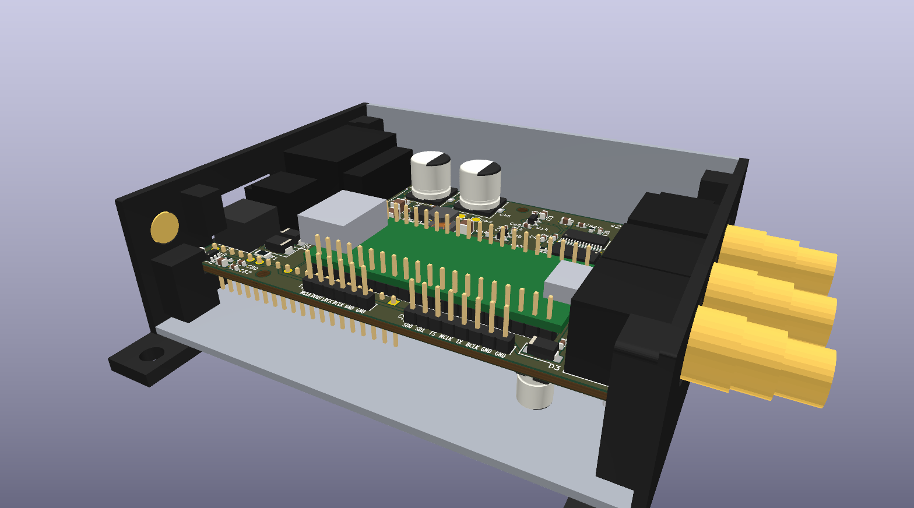
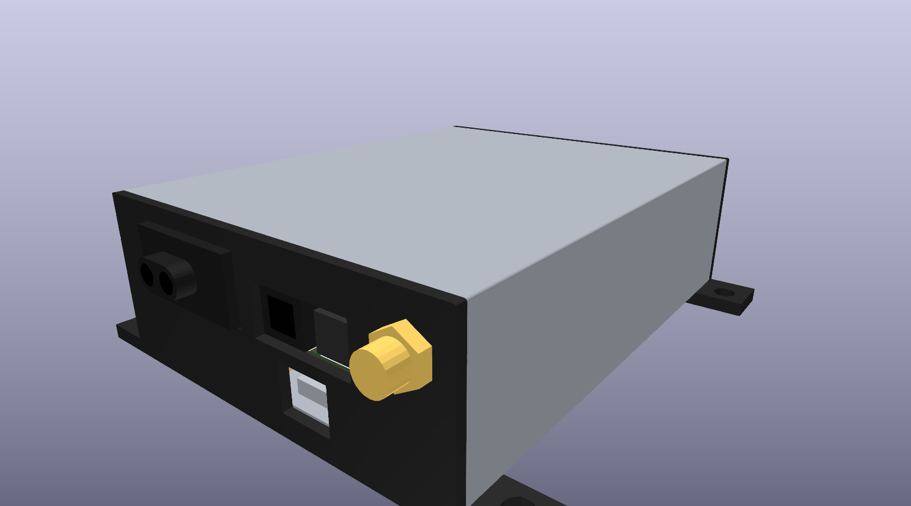
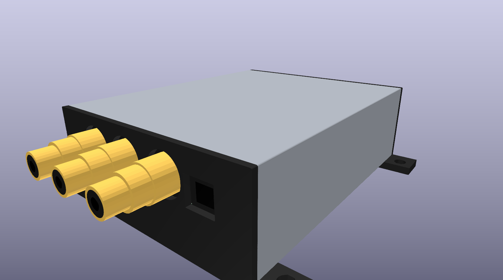
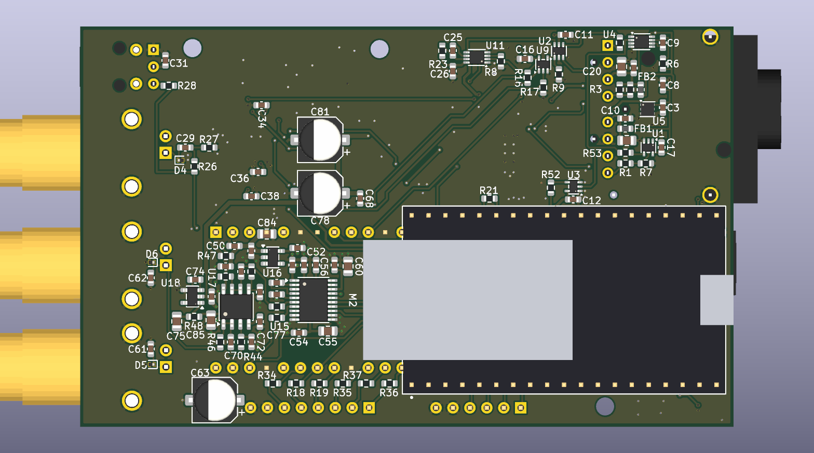

# MOST25 to AUDIO

Пасивний слухач оптичного кільця MOST25 у машині. Він стоїть у волокні як невидимий повторювач —
фізично присутній, але ніколи не вузол: без адреси, без жодного слова в каналі керування, — і
перетворює те, що несе кільце, на звук і дані, якими може користуватися власник:

- **J3: те, що грав би штатний підсилювач**, як стерео I2S і тим самим потоком як S/PDIF на TOSLINK
  і коаксіальному виході: основне джерело з гучністю, вимкненням звуку, балансом, низькими,
  високими й тонкомпенсацією, які задає головний пристрій, а також ще до трьох приймачів
  підсилювача — навігація й телефон, парктронік, службові сигнали, якщо машина передає їх звуком, —
  які мікшуються на власних
  рівнях. Тож динаміки, перенесені на підсилювач або DSP на вибір власника, зберігають органи
  керування машини і її голоси;
- **J2: усе, у сирому вигляді**: кожен байт кадру на двох лініях TDM8, блоки каналу керування на
  UART, MCLK від кільця — для аналізатора або DSP. J2 і J3 показують кадр таким, яким він виходить
  зі слухача: коли телефон грає в канали AUX машини, вони несуть телефон, так само як штатний
  підсилювач, що стоїть після слухача;
- **звук телефона в машину**: потік Bluetooth телефона, поки він грає, а інакше те, що грає на вхід
  TOSLINK плати, замінює байти власного джерела AUX машини, поки підсилювач їх грає, тож його чути
  через штатну систему зі штатними органами керування.

**Статус на 2026-10-12: спроєктовано й перевірено в симуляції, тестах хоста і збірках, але ще
жодного не виготовлено й не випробувано в машині.** Усі файли, щоб замовити, прошити й зібрати
слухача, лежать у цьому репозиторії.

**Це дослідницький проєкт.** Будемо раді кожній знахідці, запису, виправленню чи будь-якій
допомозі: відкрийте issue або pull request чи напишіть у темі на форумі.

Його нащадок, [JLR-MOST-Reader](https://github.com/Oleg-mk/JLR-MOST-Reader), — це той самий
приймач, блок DSP, кодер S/PDIF і оптичний вхідний вузол, урізані до однієї задачі на Jaguar і Land
Rover: стерео підсилювача на виході TOSLINK.



English: [README.md](README.md).

## Які машини

- **Що має бути в машині:** кільце MOST25, яке несе звук розважальної системи до окремого
  підсилювача як звичайний PCM. У машинах без такого зовнішнього підсилювача звук лишається
  всередині головного пристрою, і кільце несе його мало або зовсім не несе; потік із захистом від
  копіювання (DTCP) теж не дає що грати. Те, що в машині є MOST25, ще не робить її такою: скаже
  лише запис саме цієї машини.
- **Обидві частоти кільця:** 48 кГц (Jaguar і Land Rover) і 44.1 кГц (Audi MMI 2G/3G/3G+, BMW
  E65/F01). Приймач визначає тривалість біта з лінії, а такт регенератора центрується на виміряній
  частоті.
- **Органи керування:** усі джерела сходяться в тому, що PCM на кільці однаковий за будь-якої
  гучності, а гучність, баланс, тембр і рівні мікшера накладає підсилювач. Тому слухач читає канал
  керування й накладає їх сам. Відомо для Jaguar і Land Rover (рівні шлюзу 0xF0.0x409 і
  SpeakerLevel підсилювача 0x22.0x46D) і BMW (AudioMaster 0x20.0x200); для Mercedes, VAG і Volvo це
  не опубліковано. Кожна шкала — заглушка, доки кільце цієї машини не записано, а інструмент для
  цього — запис консолі самого слухача (`listener_fw/README.md`, «Recording»). Доки слухач не
  почує жодного з відомих йому повідомлень гучності, J3 мовчить (крім службових сигналів).
- **Телефон у машину** потребує, щоб AUX машини був джерелом MOST: де AUX мікшується всередині
  головного пристрою, там немає байтів AUX, які можна замінити. А ще слухач має стояти на волокні,
  що йде в підсилювач: телефон потрапляє в кадри, коли вони виходять зі слухача, тож його чують
  лише вузли після нього. Для прослуховування підходить будь-яке місце в кільці.

[docs/vehicle_survey.md](docs/vehicle_survey.md) перелічує кожну машину з джерелами відомостей про
неї і тим, наскільки певний кожен факт.

## Чи безпечно для кільця машини?

- **Шлях кільця:** оптичний приймач, буфер, мультиплексор (U2) і оптичний передавач. U2 пропускає
  або власний сигнал волокна, або регенерований сигнал FPGA. Цей шлях живиться від постійних 3.3 В
  (3V3_AON, U5), які беруться з KL30 і на припаркованій машині споживають десятки мікроампер.
- **Обхід:** U2 повертається до власного сигналу волокна щоразу, коли FPGA вимкнена чи не
  сконфігурована, ще не синхронізувалася з кільцем або зупинилися фронти її передачі; в останньому
  випадку це робить сторож (U11), навіть якщо такти FPGA зникли. Тож якщо відмовлять FPGA, її такти
  чи регенерація, кільце й далі проходить напряму.
- **Перемикання:** коли слухач захоплює кільце й переводить його з простого шляху на
  перегенерований, кільце бачить короткий стрибок фази, так само як тоді, коли будь-який вузол MOST
  виходить зі свого обходу на старті. Наступний вузол знову захоплює сигнал за кілька кадрів, а
  підсилювач може на цю мить приглушити звук.
- **Коли кільце розривається:** обхід — це електричний шлях, а не оптичний. Якщо зникне його
  живлення (згорить запобіжник, від'єднають KL30) або відмовить оптична деталь, кільце розірветься,
  як і з кожним штатним вузлом MOST. Поставте власний запобіжник там, де підключаєтеся до KL30.
- **Нічого нового в мережі:** жодної адреси, жодного слова в каналі керування. Доки підмішування не
  дозволено, кадри виходять такими, якими прийшли.
- **Підмішування вимкнене, доки ви його не дозволите** ('i' на консолі хоста, зберігається у флеші;
  на новому модулі воно вимкнене). Тоді воно замінює лише байти власного джерела AUX машини, поки
  підсилювач їх грає, а FPGA вимикає його через 2 с після останньої команди хоста, тож хост, що
  завис, прибирає телефон.
- **Повністю оборотно:** від'єднайте кабель-вставку, і машина знову як із заводу.

## Статус: що доведено, а що ні

**Перевірено в моделях** (запустіть `python check_all.py`; на комп'ютері автора проходять усі 44
кроки, а `--sweep` додає 32 випадкові кільця):

- Гейтвер, в Icarus Verilog проти моделей на Python:
  - приймач і блок J3 на 48 і 44.1 кГц, слово в слово зі своєю моделлю;
  - вихід S/PDIF, декодований назад;
  - усе ядро від оптичної лінії, у 14 сценаріях: обидві частоти, варіанти преамбули, підмішування,
    розриви в блоках керування, зниклий зворотний сигнал передачі (TX_FB), зупинений такт, бітові помилки,
    старт Si514 і його втрата, захоплення, плавні переходи, строк дії дозволу на підмішування і навмисна
    несправність, яку перевірки мусять зловити;
  - петля такту регенератора і 32 випадкові кільця.
- Прошивка хоста: її тести на ПК і збірка ESP-IDF без попереджень. Перевірки JLR-MOST-Reader
  компілюють її декодер і таблиці підсилення й порівнюють їх зі своїми.
- Збірка Gowin проходить таймінг із запасом щонайменше 10 %; бітстрім і прошивку в `kit/2_flash`
  зібрано з закомічених джерел.
- Плати: ERC і DRC чисті, без розбіжностей між схемою й платою, для v1.6 і v2.0; схему v2.0
  звірено зі схемою v1.6 деталь у деталь і з'єднання в з'єднання; те, як плата лягає в трубу, і
  кришки труби — з однієї моделі; пакети для фабрики й комплект відтворюються з коміту.
- Записувач і програма розбору для ноутбука — проти власних форматів хоста.

**Невідомо до перевірки на столі чи в машині:**

- **Лінія:** повний шаблон преамбули, який її варіант позначає початок блока, правило парності.
  Симуляції їх припускають; захоплення (команда 04) з'ясує їх на першому ж кільці.
- **Шкали для кожної машини:** гучність, тембр і рівні мікшера лишаються заглушками до запису
  органів керування цієї машини.
- **Власні повідомлення машини:** чи штатний головний пристрій узагалі надсилає 0x22.0x111 Connect
  (з нього J3 і телефон у машину беруть свої канали); яке з повідомлень, 0xF0.0x409 чи SpeakerLevel,
  отримує підсилювач Jaguar XF, і позиції байтів у 0x409 (з одного розбору); чи JLR глушить звук
  через 0x113, чи через 0x466 MuteParameters; чи парктронік і службові сигнали йдуть кільцем як
  звук, як каже для JLR посібник mObridge. Захоплення й запис з'ясують і це.
- **Справжнє залізо:** жодна плата ще не була під живленням, регенерація ще ніколи не працювала в
  справжньому кільці, і жоден справжній приймач S/PDIF ще не приймав вихід.

Запуск іде в три кроки, кожен із записом (нижче, «Запуск, у такому порядку»).

## Зібрати

Повна інструкція українською лежить у `kit/`: [kit/README.md](kit/README.md) і папки комплекту,
разом з усіма файлами, щоб замовити, прошити й змонтувати; англійською — у [BUILD.md](BUILD.md). Є
дві плати з тією самою схемою. **v2.0** (`listener_hw2/`) — та, яку треба робити: 98 x 60 мм,
чотири шари, усередині алюмінієвої труби 80 x 30 x 2 мм із двома торцевими кришками, надрукованими
на 3D-принтері. v1.6 (`listener_hw/`) — перша, пласка плата, 123.55 x 78.9 мм на двох шарах.





1. **Замовити плати** в JLCPCB, із монтажем SMD-деталей з обох боків. Усе лежить у
   `listener_hw2/fab/` і скопійоване в `kit/1_boards/`. Одна плата дає три збірки:

   | Збірка | Що працює | Деталей ставить JLCPCB |
   |---|---|---|
   | min | ядро і виходи S/PDIF: J6 (TOSLINK) і J7 (коаксіальний) | 103 |
   | mid | min і лінійний вихід, J8 і J9 | 143 |
   | max | mid і вхід TOSLINK, J5 | 163 |

   U7 (Si514) на складі JLCPCB немає: надішліть свій або доручіть JLCPCB замовити його наперед.
   Підходить будь-який варіант 3.3 В CMOS у корпусі 3.2 x 5 або 2.5 x 3.2, наприклад
   514CBB000112BAG, який DigiKey продає поштучно, а JLCPCB може замовити наперед (C1670489).
2. **Купити деталі для ручного монтажу:** J1 (TE 1-1394640-1, оптичний роз'єм FOT для MOST: лише на
   маркетплейсах, шукати заздалегідь), J4 (Molex 43650-0200), J5 і J6 (Cliff FCR684208R і
   FCR684208T), J7..J9 (BKL Electronic 0101153), J2 і J3 (гребінки), M1 (Sipeed Tang Nano 20K), M2
   (Espressif ESP32-DevKitC-VIE) і гребінки для модулів.
3. **Корпус:** труба, відрізана за довжиною запаяної плати; дві кришки, надруковані з
   `listener_hw2/caps/` з PETG або ASA; пігтейл U.FL–SMA 150 мм і антена 2.4 ГГц; гвинти.
4. **Прошити обидва модулі до того, як їх запаяти** (`kit/2_flash/`): коли M1 уже на платі, його
   USB-C закривають гнізда RCA.
5. **Змонтувати, увімкнути на столі, потім вставити в трубу**, як описано в
   `kit/1_boards/README.md` (англійською — у BUILD.md).
6. **У машині** — по одному кроку, кожен із записом (`kit/3_laptop/`): спершу обхід і
   прослуховування, далі регенерація, далі підмішування.

Ще потрібні живлення 12 В від KL30 із власним запобіжником і кабель-вставка, що розриває кільце біля
одного вузла й заводить його на J1 (такі роблять Kufatec, Dension і Trioma).



## Орієнтовна вартість

| Що | Приблизно, USD | Звідки (станом на 2026-10-12) |
|---|---|---|
| JLCPCB: 5 плат, 2 з них змонтовані з обох боків | min 200-230, mid 225-255, max 275-310, плюс доставка й податки | розрахунок JLCPCB і сторінка цін на монтаж: 5 плат без монтажу (4 шари, ENIG) $25; SMD з обох боків потребує Standard PCBA: $51 за підготовку і $16 за трафарет для обох боків, плюс $1.53 за кожен рядок деталей; деталі на дві плати від $25 (min) до $75 (max), з яких у max більшість припадає на U13 (SRC4192, близько $17.56); два Si514 на попереднє замовлення, $17-24 |
| Sipeed Tang Nano 20K | 26-32 | $25 на старті продажів; Spotpear $31.90 |
| Espressif ESP32-DevKitC-VIE | 11-14 | DigiKey $11.00 |
| TE 1-1394640-1 (J1) | близько 22, плюс доставка | одне оголошення на eBay; жоден дистриб'ютор його не має |
| Cliff FCR684208R і FCR684208T (J5, J6) | 13 | DigiKey $7.83 + $5.22 |
| 3 x BKL Electronic 0101153 (J7..J9) | 28-33 | Bürklin, €8.35-9.94 за штуку |
| J4 з вилкою, гребінки | 3-6 | DigiKey |
| Труба, друковані кришки, гвинти | 3-12 | труба близько 335 грн за метр; 23 г PETG |
| Пігтейл U.FL–SMA і антена 2.4 ГГц | 4-11 | Adafruit 851 $3.95; антена TE Linx $7.13 |
| Перехідник для вставки в кільце MOST, кабель TOSLINK | 25-50, плюс доставка | розгалужувач MOST25 на Tindie $20, набір Dension близько €40, залежно від вузла, до якого підключаєтеся; TOSLINK $5-7 |

Перший слухач обійдеться приблизно в $335-425 для min, $360-450 для mid і $410-505 для max, плюс
доставка й податки. Друга плата з того самого замовлення вже змонтована й оплачена: її модулі, ручні
деталі, корпус і кабелі додають близько $135-195. Більшу частину замовлення становлять фіксовані
платежі JLCPCB за монтаж обох боків, тож що більше плат в одному замовленні, то менше коштує кожна.

## Карта репозиторію

| Папка | Що | Чим зроблено |
|---|---|---|
| [listener_hw2](listener_hw2) | **плата v2.0, та, яку замовляти**: схема v1.6 на 98 x 60 мм і чотирьох шарах, для алюмінієвої труби 80 x 30 x 2 мм; схему пише `gen_listener2.py` з генератора v1.6, а `tools/check_v2_circuit.py` звіряє її з v1.6; пакет для виробництва трьох збірок у `fab/` пише `make_fab2.py`; плату в трубі моделює `check_fit.py`, дві друковані торцеві кришки в `caps/` пише `gen_caps.py`; зображення у `views/` рендерить `make_views.py` — див. «Плата v2.0» | Python, KiCad 10 |
| [listener_hw](listener_hw) | плата v1.6, перша, і джерело схеми: один аркуш KiCad 10, який генерує `gen_listener.py` (разом із символами й посадками, накресленими за кресленнями виробників: Si514, корпуси TOSLINK, гніздо RCA, обидва модулі; а також із тілами FOT, корпусів TOSLINK і гнізда RCA для 3D-вигляду); пакет для виробництва в `fab/` пише `make_fab.py`: Gerber-файли й файли свердління, BOM, файл розміщення, а також BOM і CPL для JLCPCB, щоб замовити плату з монтажем SMD-деталей; вхід TOSLINK через DIR9001 і SRC4192, вихід S/PDIF на TOSLINK і коаксіальний; стерео J3 як аналоговий лінійний вихід на два RCA через PCM5102A і буфер OPA1678 з фільтром нижніх частот 60 кГц; тестові точки для стола. Друковану плату, 123.55 x 78.9 мм на двох шарах, спершу розклав `gen_listener_pcb.py` з тієї самої схеми (місце кожної деталі й чому воно таке — у цьому файлі), потім її розставили вручну в KiCad і розвели над суцільною землею — див. «Плата v1.6» | Python, KiCad 10 |
| [listener_gw](listener_gw) | FPGA (Sipeed Tang Nano 20K): приймач, регенератор на такті, прив'язаному до кільця (Si514, яким керує FPGA), виходи TDM/UART, блок DSP для J3 і його двійник на S/PDIF, підмішування звуку від хоста або з входу S/PDIF | Gowin EDA 1.9.12; симуляція: Icarus Verilog (OSS CAD Suite) |
| [listener_fw](listener_fw) | хост ESP32 (M2, ESP32-DevKitC-VIE): вхід Bluetooth A2DP (AAC, SBC), переведення частоти телефона в частоту кільця, розбір телеграм MOST, модель підсилювача, коефіцієнти J3, кнопки треків на кермі — до телефона (AVRCP) | ESP-IDF v6.1; тести хоста: gcc |
| [virtual_most_source](virtual_most_source) | кадри MOST25 і лінійне кодування Biphase Mark — стимул для симуляцій | Python + numpy |
| [tools](tools) | `console_log.py`: повний запис консолі хоста на ноутбуці, підключеному до USB-порту M2, з позначками й тривогами (порт утрачено, ESP32 стартував заново, росте лічильник втрат, тиша); `trace_decode.py`: цей запис удома — кожна телеграма, значення звуку, з яких визначають шкали машини, телеграми біля кожної позначки, старти, втрати й тиша, і кожен дамп через `capture_analyse.py`: що каже запис справжньої лінії (UI і швидкість, шаблони преамбули, маркер блока, правило парності, керувальні біти кадру); кожна програма зі своїм тестом (формати консолі проти власних форматів host.c, вигаданий запис, відомі кадри) | Python; pyserial для записувача |
| [kit](kit) | те, що проєкт віддає, без решти репозиторію: `1_boards` — замовлення v2.0 (файли JLCPCB для трьох збірок, BOM, PDF схеми й креслень монтажу, деталі для ручного монтажу, друковані кришки труби, перше живлення, складання в трубу), `2_flash` — бітстрім FPGA і прошивка хоста з поясненням, як записати кожне з них з Windows або macOS, `3_laptop` — записувач і програма розбору з файлами запуску; пише `tools/make_kit.py`, збірки — лише із закомічених джерел, перевіряє `check_all.py` | README українською; те саме англійською — [BUILD.md](BUILD.md) |
| [BUILD.md](BUILD.md) | інструкція зі збирання англійською: замовлення, деталі, прошивка, монтаж, труба, перше живлення, записувач на ноутбуці | - |
| [SOURCES.md](SOURCES.md) | звідки знання про MOST25, про повідомлення машин і про деталі | - |
| [docs](docs) | формати керування MOST, які розбирає хост, які машини несуть звук і як вони передають гучність, дослідження, на якому стоїть такт регенератора | - |

README кожної частини розповідає, як вона працює, що перевірено і як.

## Збірка й перевірки

```text
python check_all.py            everything, one step at a time (~40 min)
python check_all.py --quick    without the clock loop's long runs
python check_all.py --sweep    plus the whole core over 32 random rings (~1 h more)
```

Скрипт запускає кроки суворо один за одним і ні на чому не зупиняється: кожен крок друкує PASS або
FAIL, а підсумок їх перелічує. Скрипти симуляцій теж запускають лише одну симуляцію за раз (кілька
водночас уже вішали цей комп'ютер). Інструменти, яких він чекає (їх можна перевизначити змінними
середовища, див. заголовок скрипта): OSS CAD Suite у `~/toolchains/oss-cad-suite`, Gowin EDA у
`C:\Gowin\Gowin_V1.9.12.03_x64`, ESP-IDF v6.1 у `~/toolchains/esp-idf` (інструменти в
`~/toolchains/espressif`), MinGW gcc у `~/toolchains/mingw64`, KiCad 10.

## Плата v2.0

v2.0 (`listener_hw2/`; у KiCad 10 її відкриває `most_listener_v2.kicad_pro`) — плата для
замовлення: схема v1.6 на платі 98 x 60 мм із чотирма шарами, яка всувається в алюмінієву трубу
80 x 30 x 2 мм, закриту двома друкованими кришками. Входи стоять на одному краї — J1 (FOT кільця), J5
(вхід TOSLINK), J4 (живлення), — а виходи на іншому — J6 (вихід TOSLINK), J7 (коаксіальний S/PDIF),
J8 і J9 (лінійний вихід). M1 (FPGA) стоїть зверху; M2 (хост) висить знизу, компонентами донизу,
його micro-USB на вхідному краї. In1 і In2 — суцільна земля під обома сигнальними шарами.

- **Схему** вдруге не малювали. `gen_listener2.py` завантажує `gen_listener.py` від v1.6 і пише його
  блоки з титулом і UUID v2.0, J5 і J6 як Cliff ORJ-8/OTJ-8 (10 мм заввишки, без вуха під гвинт),
  посадки модулів з отворами лише під задіяні ніжки й кутові, а також деталі, які додав огляд
  2026-10-11: R47 10R + C84 10u і R48 10R + C85 10u фільтрують живлення лінійного виходу, R49..R51
  (33R) стоять у BCLK, LRCK і DOUT шини I2S, R52 (33R) — у RX_IN біля U3, R53 (33R) — на виході
  U1. `tools/check_v2_circuit.py` звіряє схему зі схемою v1.6 деталь у деталь і з'єднання в
  з'єднання, без цих деталей, тож гейтвер, прошивка й `kit/2_flash` годяться для обох плат.
- **Друковану плату** один раз розставив `gen_listener2_pcb.py`, її розвели, а далі правили раунд за
  раундом у редакторі плат; блок FOT кільця — той самий, що в зчитувача v2.0 (JLR-MOST-Reader).
  Вона проходить DRC без жодної помилки, без нез'єднаних місць і без розбіжностей зі схемою.
- **Три збірки, одна плата й один корпус.** Усі роз'єми ставляться в кожній; збірки різняться
  деталями за роз'ємами: min (ядро й виходи S/PDIF), mid (+ лінійний вихід), max (+ вхід TOSLINK).
  `make_fab2.py` пише `fab/` з плати й схеми: Gerber-файли й файли свердління, BOM, розміщення обох
  боків, BOM і CPL для JLCPCB для кожної збірки, схему й креслення монтажу обох боків і README з
  кроками замовлення.
- **Труба.** `check_fit.py` моделює плату в трубі з друкованої плати й висоти кожної деталі, кожна
  висота — зі своїм джерелом: плата по центру впоперек, по 8 мм з кожного боку, на такій висоті, що
  над найвищими деталями зверху (гнізда RCA) і під M2 лишається однаковий запас; грань кожної
  деталі відносно її кришки; виводи під платою; вікна кришок і стінки між ними. `gen_caps.py` пише
  кришки в `caps/` (STEP, STL, креслення, README) і не пише нічого, якщо стінка виходить тоншою,
  ніж може надрукувати принтер, або блок натрапляє на деталь чи вивід. Кожна кришка — це фланець на
  торці труби, блоки в бічних запасах, що тримають краї плати в пазах, на 0.7 мм від стінок труби,
  щоб підійшла будь-яка труба в допуску, і сідло під трубою з вухом з кожного боку, щоб її
  пригвинтити. Вхідна кришка пропускає J1, J5 разом із J4, micro-USB модуля M2 і гніздо SMA антени
  Bluetooth; вихідна — J6 і гнізда RCA.
- **Чого вимагає труба.** USB-C модуля M1 опиняється за корпусами RCA, тож FPGA прошивають до того,
  як M1 запаяно, і в зібраній платі прошити її не можна; micro-USB хоста лишається доступним крізь
  вхідну кришку — для його прошивки й для запису на ноутбуці. J2 і J3 — для стола: колодка під
  обтиск на них стояла б на 16.4 мм заввишки, а труба лишає 14.75.
- **Зображення** тут рендерить `make_views.py` з тих самих моделей. У KiCad немає тіл для модулів і
  чотирьох деталей, замість них стоять прості коробки.

`check_all.py` заново генерує схему v2.0 і звіряє її зі схемою v1.6, запускає ERC і DRC, запускає
`check_fit.py` і `gen_caps.py` і падає, поки `fab/` чи `caps/` відрізняються від того, що пишуть
їхні скрипти. `kit/1_boards` передає v2.0: замовлення кожної збірки, деталі для ручного монтажу,
трубу з кришками, складання в трубу.

## Плата v1.6

Плата v1.6 — перша плата, на двох шарах; її схема — це й схема v2.0. Проєкт у KiCad 10 відкриває
`listener_hw/most_listener.kicad_pro`. Схема генерується (`gen_listener.py`); друковану плату
один раз розклав `gen_listener_pcb.py`, потім її розставили вручну в редакторі плат і розвели.
Відтоді головним є `most_listener.kicad_pcb`: деталі можна вільно рухати, а генератор відмовляється
перезаписувати файл, якщо його не запущено з `--fresh`, з яким він знову розкладає деталі за своєю
таблицею й викидає всі доріжки.

Що вже є на платі: контур (123.55 x 78.9 мм, два шари), чотири отвори M3 приблизно за 4 мм від
своїх країв, заливки землі з обох боків (їх заливає клавіша B), заборона міді під антеною M2, класи
ланцюгів — Default: доріжки 0.25 мм із зазором 0.15 мм, Rail: 0.35 мм для шин 3.3 В, Power: 0.6 мм
для шляху від акумулятора й шин 5 В, переходи 0.6/0.3 і 0.8/0.4 мм — і `most_listener.kicad_dru`,
яке дозволяє з'єднати площадку із заливкою однією спицею термобар'єра, що справді утворилася.
Причини, з яких кожна деталь стоїть на своєму місці, — у таблиці генератора.

Розводка (плата v1.6): низ — одна суцільна земля, яку перетинають лише короткі перемички (їх 4,
разом 9 мм, найдовша 3.65 мм); сигнали й живлення йдуть зверху, живлення — широкими доріжками, які
ніде не переходять на інший шар, крім однієї перемички 3V3_AON, а верхня заливка землі зшита з
суцільною землею переходами приблизно через кожні 6 мм. У кожної SMD-площадки землі поруч є власний
перехід. Стовбур 5 В шириною 1 мм іде від C7 угору лівим краєм під J1 і далі вздовж верхнього краю;
ключ хоста U10 стоїть біля ніжки 5 В модуля M2, з конденсатором 10 мкФ на вході (імпульси радіо
беруться з нього, а не йдуть стовбуром); 100 мкФ + 100 нФ (C63, C64) стоять біля D3 на кінці
стовбура з боку модуля, 100 мкФ + 100 нФ (C81, C80) — на іншому його кінці біля U10 і U14, ще
чотири по 100 нФ (C65-C68) — уздовж нього.
v1.2 вивела кожну лінію, що йде в праву половину плати, на правий ряд M1 у тому порядку, в якому
лінії там зустрічають J2, J3, ЦАП і хост, а лінії хоста — на ряд M2, звернений до M1, тож шина під
M2 іде без жодного перетину (у v1.1 було 75 перемичок, 174 мм). Разом із цим змінився порядок
контактів J2 і J3 — J2: 1 SD0, 2 SD1, 3 FS, 4 MCLK, 5 UART_TX, 6 BCLK; J3: 1 MCLK, 2 DOUT, 3 LRCK,
4 BCLK, — і шовкографія підписує кожен контакт. v1.3 вивела далі два прапорці входу TOSLINK: AUDIO
приймача S/PDIF (біт 1 статусу каналу) — на IO27 хоста, щоб джерело, яке шле AC-3 чи DTS (DIR9001
пропускає їх недоторканими), ніколи не потрапило в машину, і RDY мікросхеми SRC4192 — на її ж MUTE,
щоб вона мовчала, поки встановлюється на нову частоту; ще чотири короткі перемички. v1.4 поміняла
кінцями 20 деталей із двома площадками там, де їхні з'єднання від цього йдуть коротше й пряміше, —
FB1, щоб RXVCC і 3V3_AON більше його не перетинали; R7, щоб U1-A падала прямо на R1, — і кожну
лишала так, лише якщо повторна розводка не коштувала жодної зайвої перемички чи переходу: на 56 мм
менше міді зверху, ті самі 37 перемичок. Потім плату переставляли група за групою й після кожної
розводили знову: вузол кільця й такту — біля J1, групу S/PDIF (U12, U13) ущільнено, ЦАП посунуто
ліворуч — 37 перемичок стали 11, 83 мм нижньої міді — 29. Ще один раунд 2026-10-02, після нових
пересувань деталей, прибрав іще три: R29 став там, де SRC_BCLK мала перетин під M2, і лінія
пройшла між його площадками; RST_AIN доходить до U12 під корпусом U13 і під C39 та X1, з R30 біля
U13 і з'єднаннями 3.3 В мікросхеми U13 поза її корпусом; R38, R40 і R41 стоять праворуч від ряду
M1, а R39 — під M2, тож BCLK ЦАП спускається під їхніми корпусами поверх свого пучка, і U15 отримує
BCLK, DOUT і LRCK у власному порядку. Останній раунд того самого дня переставив кут входу
акумулятора (F1 біля J4, постійний LDO U5 вище, біля U4, L2, D1 і D2 ліворуч, вхідні конденсатори
100 нФ понижувача повернуто до U6), U10 і U14 з їхніми конденсаторами, J2 і J3, а також ЦАП: U15 з
конденсаторами стоїть вище, а U16 з C50/C51 — поруч із нею, тож 3V3_DAC — короткий хребет під
корпусом U15. У куті Si514 RT_CLK тепер має одну перемичку під RX_BUF і SI_SCL — RX_BUF іде між
рядами площадок Si514 і над ним, CLK+ — довкола його західного боку, — а SI_SCL пірнає під 3V3_SW
біля ряду M1. Лишилися чотири перемички: RX_BUF і 3V3_AON під стовбуром 5 В між U1 і U4/U5,
RT_CLK (1.9 мм) і SI_SCL (1.3 мм). 5V_SW іде вздовж нижнього краю до U16 і буфера лінійного виходу
U17 (блок 11 схеми), зі 100 мкФ + 100 нФ (C78, C79) на кінці; C82 — ще один 100 нФ на вході
акумулятора біля L2. На одному шарі здвоєному операційному підсилювачу потрібні два перетини: 5V_SW
проходить між площадками R45, VNEG_A — під корпусом U17. Посадка Si514 приймає лише корпуси 3.2x5
і 2.5x3.2, R3 — це два по 27 кОм паралельно (R3, R42), а п'ять тестових точок (TP1, TP3, TP4, TP8,
TP10) прибрано.
v1.5 (2026-10-03) ущільнила правий і верхній краї: плата на 2.5 мм вужча й на 1.1 мм нижча. Група
DIR9001 з U14 посунулася на 1.7 мм ліворуч, J5..J9 і вихідні деталі лінійного виходу — на
2.4..3.1 мм, верхня ділянка стовбура 5 В і деталі під нею (U10, C23, C24, C63, C65, C80, C81,
D3) — на 2 мм униз; їхня мідь посунулася разом із ними. C32, C38 і C40 стоять одним рядом над
корпусом U13, а R30 — під ним біля C39: C40, біля проміжку U13-U12 (тепер 1.1 мм завширшки),
опускає RST_AIN прямо в цей проміжок поруч із живленням 3.3 В, що піднімається від лівого боку U12
до шини ряду, а земляні ніжки U13 доходять до своїх переходів під її корпусом. Перемичок так і
лишилося чотири, 9 мм.
У v1.6 (2026-10-04) J5 і J6 стали ORJ-5 і OTJ-5 від Cliff (FCR684205R/T).
PLR135/T10 від Everlight більше не випускають, а його наступника PLR237/T10BK немає на складах.
Посадка йде за кресленнями Cliff: вигляди ззаду, зліва й з боку порту (проєкція третього кута) і
розмітка плати, прочитані шість разів незалежно. Ніжки стоять із кроком 2.54 мм, ніжка 1 —
праворуч від порту. Один фіксатор стоїть на 3.90 мм перед ніжками, а два, на відстані 9.20 мм один
від одного, — на 2.10 мм за ними. Передня грань корпусу — на 8.50 мм перед ніжками, на краю плати,
а шторка — ще на 2.30 мм далі. Функції стоять там, де їх мав T10; лише номери ніжок ідуть у
зворотний бік. Корпус має 11.5 мм завширшки проти 9.7 у T10 і 19 мм заввишки проти 10. Тому гнізда
правого краю J5..J9 і H2 посунулися приблизно на 1.1 мм праворуч (вручну), а плата виросла до
123.55 мм. Мідь біля пересунутих ніжок перемальовано: вихід J5 тепер іде між ніжками й передніми
фіксаторами і виходить між ніжками 2 і 3 J6.
v1.6 також перенесла послідовні резистори до ніжок, які керують їхніми лініями. Шість резисторів J2
(R18, R19, R34..R37) стоять стовпчиком під лівим краєм M2, кожен навпроти проміжку в ряду M2: лінія
виходить із ніжки FPGA, проходить крізь проміжок у свій резистор і йде далі прямо до J2, тож петель
біля ряду M1 більше немає. R20 стоїть біля ніжки 35 модуля M2, а R21, у стовпчику під R36, — біля
ніжки 25: виходи хоста UART_RX і I2S_DIN заходять у них прямо, а I2S_DIN виходить із дальньої
площадки R21 під його корпусом, назад крізь ряд M2. Відгалуження UART_TX до ніжки 32 хоста тепер
повертає вгору одразу ліворуч від ніжок M1, а не довкола старих місць резисторів. R29 стоїть біля
SDOUT мікросхеми U13: SRC_BCLK іде між його площадками в U13, а DIN2 заходить знизу старим шляхом
SRC_BCLK. Діагональ лінії S/PDIF посунулася на 1 мм праворуч, щоб обійти R34.
M1 і M2 запаяно в плату на гребінках, без панельок — дві 1x20 і дві 1x19 із кроком 2.54 мм; 3D-вигляд
показує їх під модулями, як і гребінки J2 і J3. Пластик гребінок лишає 2.5 мм під кожним модулем:
місце для резисторів 0603 під M1 (R11, R12) і під M2 (R18..R21, R34..R41); courtyard модуля M2 —
це два його ряди ніжок і кінець з антеною.
У KiCad немає моделей FOT MOST, корпусів TOSLINK і гнізд RCA, тож `gen_listener.py` малює їхні тіла
з тих самих креслень, як файли STEP у `most_listener.3dshapes`.
`make_fab.py` пише пакет для виробництва в `listener_hw/fab`: Gerber-файли й файли свердління (в
архіві для фабрики), BOM, файл розміщення, ті самі два у форматі JLCPCB і README з цифрами плати й
примітками, яких немає у значеннях BOM. Повороти для JLCPCB знято з посадки LCSC кожної вибраної
деталі: таблиця спільноти ставила U4, U8..U11, U14, U16 і U18 зі зсувом на чверть оберту, а
електроліти — навпаки (2026-10-03).
`check_all.py` падає, поки пакет не відповідає платі.

Кожна посадка прив'язана до свого символу, тож після зміни схеми: запустити `gen_listener.py`,
потім у редакторі плат Tools > Update PCB from Schematic. `python check_all.py` запускає DRC KiCad
на платі як вона є, зі звіркою зі схемою; плата проходить без жодної помилки й без нез'єднаних
місць. Попередження стосуються лише шовкографії: позначення, які після ручної розстановки
налягають на площадку чи інше позначення.

## Обмеження за задумом

- **Що грає, хост дізнається лише зі світла.** Слухач ніколи не шле ні слова, тож хост дізнається,
  які байти кадру несуть джерело AUX і чи грає їх підсилювач, лише з телеграм, які йому випадає
  почути. На холодному старті кільце, FPGA й ESP32 прокидаються разом (WAKE); якщо головний
  пристрій під'єднає підсилювач до AUX раніше, ніж хост почне слухати, телефон не підмішується,
  доки головний пристрій наступного разу не змінить джерело. FPGA читає свій бітстрім із флешу
  модуля приблизно за 290 мс (25 МГц; стандартні для Gowin 2.5 МГц давали 2.9 с), тож це вікно
  тримається коротким. Спитати (SourceInfo.Get у каналі керування) означало б порушити мовчання
  слухача, тож так і лишається.
- **Машини, де AUX не є джерелом MOST** — він мікшується всередині головного пристрою, — не мають
  байтів AUX, які можна замінити; телефон туди не підмішати. Прослуховуванню (J2, J3) потрібен
  звук на волокні як звичайний PCM: машини без зовнішнього підсилювача або з потоком під захистом
  від копіювання (DTCP) не дають йому що грати (docs/vehicle_survey.md). Те, що в машині є MOST25,
  ще не робить її такою: скаже лише запис саме цієї машини.
- **Шкали для кожної машини** — гучність, тембр, рівні мікшера інших приймачів, рівні навігації й
  парктроніка Jaguar XF (байти 8 і 10 у 0xF0.0x409) — лишаються заглушками, доки не записано
  справжнє кільце.
- **Sink 4 у кожній машині — службові сигнали**, за нумерацією приймачів підсилювача від Jaguar
  Land Rover: без власного SpeakerLevel він грає на -6 дБ (зверху його MixerLevel), ніколи не на рівні гучності,
  тож сигнал чути й зі скрученою гучністю. Машина, яка ставить на sink 4 щось інше, теж отримає це
  на -6 дБ.
- **Те, що підсилювач робить сам**, на шину не потрапляє: якщо він притишує музику, поки звучить
  підказка, J3 цього не робить; він іде за тим, що шле головний пристрій (рівні, вимкнення звуку).
- **CRC каналу керування не перевіряється**: його поліному немає в жодному документі, який ми
  маємо. Що перевіряється натомість: FPGA відкидає блок, у якому лінія порушила свій код, а хост
  відкидає блок, кадри якого не збігаються за парністю (кількість, яку має чистий блок, вивчається
  на кільці). Біт усе ще може непомітно перевернутися так, що не покаже ні те, ні інше; CRC
  з'явиться, щойно запис дасть поліном.
- **Підмішування під захистом** (критичний аудит, 2026-10-03). Воно вимкнене, доки його не
  дозволено на консолі хоста ('i', зберігається у флеші), тож нічого нашого не потрапляє в кільце
  машини, доки запис цієї машини не покаже, що телеграми прочитано правильно. FPGA тримає
  «увімкнено» 2 с після останньої команди хоста (вона повторюється кожні 0.5 с), тож хост, що
  завис, прибирає наш звук. Після будь-якого розриву в блоках керування підмішування чекає, доки
  про канали AUX не буде оголошено знову (наступний Allocate.Result або SourceInfo машини для AUX),
  бо розрив міг приховати DeAllocate, який віддав ці байти іншому джерелу.

## Запуск, у такому порядку

1. **Лише обхід.** U2 лишається на власному сигналі волокна (LOCK утримується в низькому рівні),
   FPGA слухає: TDM і UART на J2 і захоплення (команда 04: FPGA зберігає перші 65536 серій лінії
   після ввімкнення, за клавішею `d` хост друкує їх дампом, `c` захоплює заново;
   `tools/capture_analyse.py` їх читає) зі справжнього кільця, записані `tools/console_log.py` і
   прочитані `tools/trace_decode.py`. Це з'ясовує те, що симуляції могли лише припустити, — шаблон
   преамбули, маркер початку блока, правило парності — і показує телеграми керування, які розбирає
   хост.
2. **Регенерація** — на столі з петлею волокна, потім у машині.
3. **Підмішування**, дозволене через 'i' на консолі лише тепер, — з телефона і з входу TOSLINK,
   потім звук J3 і шкали для кожної машини.

На столі з v1.6 (на v2.0 корпуси RCA закривають USB-C модуля M1, щойно його запаяно) тримайте J4
під живленням, поки модуль FPGA підключений до свого USB, або вставляйте цей USB лише для прошивки.
Якщо на J4 від самого початку немає живлення, модуль однаково підживлює знеструмлений ESP32 через
свою лінію UART, а Si514 — через R11/R12. FPGA не може відрізнити цей стан від Si514, який не
стартує, а UART мусить лишатися робочим, щоб це налагодити.

У машині це враховано: коли Si514 уже працював, а потім зник разом із 5V_SW (кільце спить, ноутбук
підключено до модуля FPGA), FPGA тримає кожну таку лінію в низькому рівні й заново центрує Si514,
коли той повертається (listener_gw/README.md, «Ring clock»). Навпаки — нешкідливо: ESP32 на своєму
USB подає сигнали на знеструмлений модуль FPGA через R20/R21, а входи GW2AR допускають гаряче
підключення зі струмом щонайбільше 150 мкА (DS226, табл. 3-4).

Вхід від акумулятора розраховано на ISO 16750-2, тест B (скидання навантаження з придушенням, 35 В
до 400 мс), та імпульси 1, 2a, 3a і 3b за ISO 7637-2: понижувач — LMR38020 (80 В на вході, 85 В
абсолютний максимум), TVS — SMBJ36A перед діодом захисту від переполюсування (на 35 В закритий,
швидкі імпульси обмежує на рівні близько 50 В, від'ємні відводить через свій діод у прямому
напрямку), запобіжник — інерційний на 2 А, зі 100 нФ 100 В (C83) одразу за ним, біля TVS.
Скидання навантаження без придушення (тест A, 80..100 В) не покрито: для нього потрібен був би TVS
на 6.6 кВт, а машини епохи MOST мають генератори з лавинними діодами. Перший D2, SMBJ26CA за
діодом, згорів би при скиданні навантаження 35 В, яке сам понижувач витримує, а від'ємний імпульс
пробив би діод раніше, ніж TVS його обмежив би.

## Ліцензія

Copyright 2026 Oleg-mk.

- **Залізо — під CERN-OHL-S-2.0** ([LICENSE](LICENSE)):
  - `listener_hw/` і `listener_hw2/`: проєкти KiCad і скрипти, що їх генерують, посадки й
    3D-моделі, файли для виробництва, торцеві кришки труби, зображення;
  - гейтвер у `listener_gw/rtl/` і `listener_gw/board/`;
  - `kit/1_boards/` і `kit/2_flash/fpga/`.
- **Програми — під GPL-3.0-or-later** ([COPYING](COPYING)): `listener_fw/` (прошивка хоста),
  `virtual_most_source/`, `tools/`, `listener_gw/sim/`, `kit/2_flash/esp32/`, `kit/3_laptop/` і
  `check_all.py`.
- **Документація:** кожен README і креслення — під ліцензією папки, у якій лежить; `docs/` — під
  GPL-3.0-or-later.

Прошивку хоста зібрано з ESP-IDF від Espressif, частина бібліотек якого постачається лише у
двійковому вигляді (серед них контролер Bluetooth), і з компонентом Espressif `esp_audio_codec`
(декодери AAC і SBC), що поширюється під Espressif Modified MIT License. Як додатковий дозвіл за
розділом 7 GPL, ви можете компонувати прошивку з цими бібліотеками Espressif і поширювати поєднаний
двійковий файл за умови, що власний код прошивки поширюється під GPL.

Якщо ви робите чи змінюєте залізо й ділитеся ним, діліться своїми вихідними файлами під тією самою
ліцензією.

## Як це зроблено

Рішення ухвалював і деталі розставляв автор. Claude (модель ШІ від Anthropic, у Claude Code) як
співавтор написав гейтвер, прошивку хоста, моделі й симуляції, генератори плат і мідь, а також
перевірки. В історії комітів видно обох.

Слухач почався в попередньому проєкті автора `most-bus` (коміт 08ea5fb, 2026-09-26), де він ріс
поруч із відкладеною конструкцією на STM32 + ADAU1466; сюди перейшов лише слухач.
